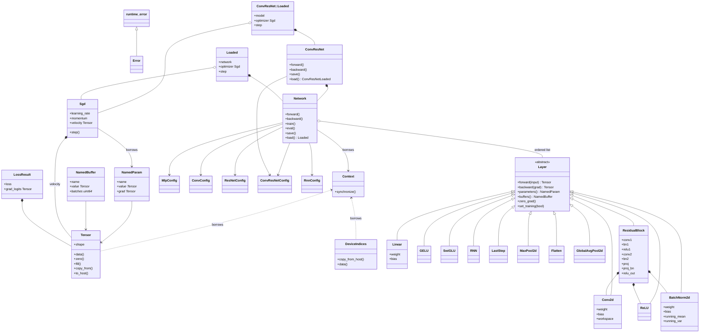

# nn

A single-GPU C++17 library that builds and trains multilayer perceptrons, convolutional networks, basic-block ResNets, and recurrent networks. `ConvResNet` is one network that can include a conv+pool trunk, residual stages, or both. Depth and width come from a config. Each trainable layer implements its own forward and backward pass. The network chains those layers. An MLP selects ReLU, GELU, or SwiGLU between its hidden linear layers. Training uses mean softmax cross-entropy and SGD with momentum. A checkpoint restores parameters, batch-norm state, the train or eval flag, and, when requested, the optimizer, so a new process can evaluate or resume training.

The acceptance suite is MNIST. Public headers live under `include/nn/` and do not include CUDA, cuBLAS, or cuDNN headers.

## Requirements

- C++17 and CMake 3.24 or newer
- CUDA Toolkit (`CUDA::cudart`, `CUDA::cublas`)
- cuDNN, found as `cudnn.h` and `libcudnn`
- One CUDA device. The library uses whichever device is current when a `Context` is created. It does not call `cudaSetDevice`.
- float32, NCHW, one non-default stream per `Context`

Default GPU architecture is `86` (`CMAKE_CUDA_ARCHITECTURES`). Set `CUDNN_ROOT`, or `CUDNN_INCLUDE_DIR` and `CUDNN_LIBRARY`, when cuDNN is not on the default search path.

```bash
cmake -S . -B build -DCMAKE_BUILD_TYPE=Release
cmake --build build -j
```

Targets:

| Target | Kind | Role |
|---|---|---|
| `nn` | static library | The library. Links `CUDA::cudart` and `CUDA::cublas` publicly and cuDNN privately. |
| `nn_tests` | executable | `shapes`, `grads`, `ckpt`, and `mnist` |

`src/tensor.cpp` is compiled as CUDA so Thrust runs on the context stream. Device symbols are resolved into the static library (`CUDA_RESOLVE_DEVICE_SYMBOLS`), and the library is built position-independent.

## Layout

```
include/nn/           public headers
include/nn/layers/    layer headers
src/                  sources, private headers, and CUDA kernels
tests/                the acceptance suite
```

Everything is in namespace `nn`.

## Classes

`Layer` is the abstract base. `Network` owns an ordered list of layers. A `ResidualBlock` owns the convolutions, batch-norm layers, and ReLUs on its main path and on its projection skip. `GELU` and `SwiGLU` are parameter-free activations. `build_mlp` places `ReLU`, `GELU`, or `SwiGLU` between hidden linear layers. `RNN` is one Elman recurrent layer. `LastStep` keeps the last time index. `ConvResNet` owns one `Network` whose family is `ConvResNet`. `build_mlp`, `build_conv`, `build_resnet`, `build_conv_resnet`, and `build_rnn` are free functions that return one `Network`. `softmax_cross_entropy` is a free function that reads a `Tensor` and a `DeviceIndices` and returns a `LossResult`.



## Ownership

`Context` owns the CUDA stream, the cuDNN handle, and the cuBLAS handle. It is neither copyable nor movable. `synchronize()` waits for that stream. Tensors, layers, losses, and the optimizer borrow the context. Destroy the context only after every object that borrowed it has been destroyed. Tensor and label destructors synchronize the stream before `cudaFree`.

`Tensor` is the only device-buffer owner. It holds a shape, a `cudaMalloc` pointer, and the byte count. Thrust and cuDNN use that same pointer. There is no `thrust::device_vector` beside the tensor. A tensor is movable and not copyable. `reshape` allocates a new tensor and copies; it is not a view.

`Layer` objects are owned by `Network` as `std::unique_ptr<Layer>`, or by a `ResidualBlock` when they are children of a block. `forward` and `backward` return a `const Tensor&` into storage owned by that layer. The reference stays valid until the next `forward` or `backward` on that same layer, or until the layer is destroyed. Copy it with `to_host()` or `copy_from` if the values must outlive the next call.

`NamedParam` and `NamedBuffer` hold raw pointers into those layer-owned tensors. `parameters()` and `buffers()` return fresh vectors of those pointers. The pointed-to storage lives as long as the network does.

`Sgd` copies the `NamedParam` list (the pointers, not the tensors) and owns one velocity tensor per parameter. The network and the optimizer must be destroyed before the context.

`DeviceIndices` owns a separate `int64` device buffer for class labels. Labels are not tensors.

`LossResult` owns `grad_logits` by value.

## Data layout and numerics

- Storage is dense float32, little-endian on the host.
- Rank-2 shape is `(N, F)`, row-major. Rank-4 shape is `(N, C, H, W)`, NCHW.
- Rank is 1, 2, or 4. Every dimension is at least 1. The element count must fit in a signed 32-bit integer.
- Linear algebra uses `cublasGemmEx` with `CUDA_R_32F`, `CUBLAS_COMPUTE_32F_PEDANTIC`, and `CUBLAS_GEMM_DEFAULT`. The handle math mode is `CUBLAS_PEDANTIC_MATH`.
- Convolutions use `CUDNN_CROSS_CORRELATION`, dilation 1, groups 1, and `CUDNN_FMA_MATH`.
- Convolution algorithms are fixed: forward `CUDNN_CONVOLUTION_FWD_ALGO_IMPLICIT_GEMM`, backward-filter `CUDNN_CONVOLUTION_BWD_FILTER_ALGO_1`, backward-data `CUDNN_CONVOLUTION_BWD_DATA_ALGO_1`. There is no algorithm search and no fallback. `CUDNN_STATUS_DEPRECATED` is a hard error.
- Spatial size is `(in + 2 * pad - kernel) / stride + 1` using integer division. `conv_out_size` throws `std::invalid_argument` when the result is below 1.

A CUDA, cuDNN, or cuBLAS failure throws `nn::Error` with the call name, a colon, and the status name, for example `cudnnConvolutionForward: CUDNN_STATUS_BAD_PARAM`.

## Training step

A new network is in train mode. One optimizer step is:

1. `network.train()` when batch-norm must update running statistics.
2. `network.zero_grad()`. Weight and bias gradients accumulate. Skipping this adds the new gradient onto the old one.
3. `const Tensor& logits = network.forward(input)`.
4. `LossResult loss = softmax_cross_entropy(ctx, logits, labels)`.
5. `network.backward(loss.grad_logits)`.
6. `optimizer.step()`.

`zero_grad` writes zeros into every parameter gradient and does not touch parameters, velocity, or batch-norm buffers. `step` applies Polyak momentum on the context stream and then increments `step_count` by one:

```
velocity = momentum * velocity + gradient
parameter = parameter - learning_rate * velocity
```

There is no weight decay and no Nesterov term. The learning rate can be changed with `set_learning_rate`. Momentum is fixed after construction.

Call `network.eval()` before inference. Eval batch-norm uses the stored running mean and variance and does not change them. `backward` on a batch-norm layer in eval mode throws.

## Initialization

`build_mlp`, `build_conv`, `build_resnet`, `build_conv_resnet`, and `build_rnn` take a `uint32_t` seed and construct layers with one `std::mt19937`. Each weight tensor draws Kaiming normal values with standard deviation `sqrt(2 / fan_in)` and consumes the generator. Biases are zero and do not consume it. Batch-norm scale is filled with 1, batch-norm bias with 0, running mean with 0, and running variance with 1. The batch counter starts at 0.

Fan-in is `in_features` for `Linear`, `in_channels * kernel * kernel` for `Conv2d`, `input_size` for `RNN` `weight_ih`, and `hidden_size` for `RNN` `weight_hh`.

Generator order follows construction order:

- MLP: `fc.0.weight`, `fc.1.weight`, ...
- ConvNet: each `conv.i.weight`, then each `fc.i.weight`
- ResNet: `stem.weight`, then each block's `conv1.weight`, `conv2.weight`, and `proj.weight` when the block has a projection, then `head.weight`
- ConvResNet: each `conv.i.weight`, then `stem.weight` when the stem is present, then each block's `conv1.weight`, `conv2.weight`, and `proj.weight` when the block has a projection, then each `fc.i.weight`
- RNN: for each recurrent layer, `rnn.i.weight_ih` then `rnn.i.weight_hh`, then `head.weight`

`load` rebuilds with seed 0 and then overwrites every parameter from the file. The seed used at load time does not affect the restored weights.

## Configurations

`validate` checks a config before a builder allocates. A failed check throws `std::invalid_argument` whose message is the field name (`"input_size"`, `"hidden"`, `"kernel"`, `"spatial"`, `"stage_widths"`, and the same pattern for the other fields).

### MlpConfig

| Field | Meaning |
|---|---|
| `input_size` | Features in one example. |
| `hidden` | Width of each hidden layer, in order. Empty is legal and builds a single linear map. |
| `output_size` | Logit width. |
| `activation` | `Activation::Relu` (1), `Activation::Gelu` (2), or `Activation::SwiGLU` (3). |

`Relu` and `Gelu` keep each hidden width. The builder emits `Linear`, the activation, `Linear`, the activation, ..., `Linear`. The last linear layer has no activation. A hidden width `H` is the output width of that linear layer.

`SwiGLU` uses `H` as the width after the gate. The linear layer before each `SwiGLU` writes `2H` features. `SwiGLU` returns `H` features, and the next linear layer reads `H`. The last linear layer writes `output_size` and has no gate. An empty `hidden` is one linear layer for every activation. On a hidden layer, `fc.i.weight` has shape `(2H, in)`.

Layer names are `fc.0`, `fc.1`, ... Input shape is `(N, input_size)`. Output shape is `(N, output_size)`.

### ConvConfig

| Field | Meaning |
|---|---|
| `in_channels`, `in_height`, `in_width` | Input image size. The batch dimension is chosen by the caller at `forward`. |
| `convs` | One `ConvSpec` per stage: `out_channels`, `kernel`, `stride`, `pad`. At least one. |
| `pool` | `PoolSpec` applied after every convolution. Padding is 0. |
| `fc` | Fully connected widths, ending with the logit width. At least one. |

Kernels are square. Each stage is `Conv2d` (bias on), `ReLU`, `MaxPool2d`. The builder then inserts `Flatten` and the linear head. Hidden linear layers are followed by `ReLU`. Names are `conv.i`, `pool.i`, and `fc.i`. `Flatten` and `ReLU` have empty names and no parameters.

### ResNetConfig

| Field | Meaning |
|---|---|
| `in_channels`, `in_height`, `in_width` | Input image size. |
| `stem_channels` | Channels after the stem. |
| `blocks_per_stage` | Basic blocks in each stage. Same length as `stage_widths`. Each entry is at least 1. |
| `stage_widths` | Output channels of each stage. |
| `output_size` | Logit width. |

The stem is `Conv2d` 3×3, stride 1, pad 1, bias off, named `stem`, then `BatchNorm2d` named `stem.bn`, then `ReLU`. Stage 0 uses stride 1. Each later stage downsamples with stride 2 on its first block. The remaining blocks in a stage use stride 1. After the stages the builder appends `GlobalAvgPool2d`, `Flatten`, and `Linear` named `head`.

A block is named `stages.{s}.blocks.{b}`.

### ConvResNetConfig

| Field | Meaning |
|---|---|
| `in_channels`, `in_height`, `in_width` | Input image size. |
| `convs` | Optional trunk. Each `ConvSpec` is `Conv2d` (bias on), `ReLU`, `MaxPool2d`. Empty is legal when residual stages are present. |
| `pool` | `PoolSpec` applied after every trunk convolution. Padding is 0. Unused when `convs` is empty. |
| `stem_channels` | `0` omits the stem. A positive value inserts the same 3×3 stride-1 pad-1 bias-off stem, `BatchNorm2d`, and `ReLU` used by `ResNetConfig`, and requires residual stages. |
| `blocks_per_stage` | Basic blocks in each residual stage. Empty is legal when `convs` is nonempty. Each entry is at least 1. |
| `stage_widths` | Output channels of each stage. Same length as `blocks_per_stage` when stages are present. |
| `fc` | Fully connected widths, ending with the logit width. At least one. |

At least one of `convs` and `blocks_per_stage` must be nonempty. Stage 0 uses stride 1. Each later stage downsamples with stride 2 on its first block. A projection exists when stride is not 1 or the channel count changes.

When stages are present the builder appends `GlobalAvgPool2d`, `Flatten`, and the linear head. The first linear layer sees the last stage width. When stages are absent it appends `Flatten` and the linear head, and the first linear layer sees `channels * height * width` after the trunk. Hidden linear layers are followed by `ReLU`. Names are `conv.i`, `pool.i`, `stem`, `stem.bn`, `stages.{s}.blocks.{b}`, and `fc.i`.

```cpp
nn::ConvResNet model(ctx, config, /*seed=*/1);
model.save(path, &optimizer);
nn::ConvResNet::Loaded loaded = nn::ConvResNet::load(ctx, path, nn::LoadMode::Resume);
```

`ConvResNet` forwards `forward`, `backward`, `train`, `eval`, `zero_grad`, `parameters`, and `buffers` to the network it owns. Constructing it from a `Network` of another family throws `ConvResNet family`. `ConvResNet::load` throws `bad checkpoint family` when the file is another family. `save` writes family `4` in the same version-1 checkpoint.

### RnnConfig

| Field | Meaning |
|---|---|
| `input_size` | Features at one time step. |
| `hidden` | Width of each Elman layer, in order. At least one. |
| `output_size` | Logit width. |

`build_rnn` emits one `RNN` per hidden width, named `rnn.i`, then `LastStep`, then `Linear` named `head`. The state before the first step is zero and is not a parameter. Each layer reads the full sequence from the layer below. `LastStep` keeps time `T - 1`. The head maps that vector to `output_size`.

Input shape is `(N, T, input_size)`. Output shape is `(N, output_size)`. `T` is at least 1.

### MNIST shapes

MLP `784 → 256 → 128 → 10` takes `(N, 784)` and returns `(N, 10)`.

ConvNet on `1×28×28` with `{32, k5, s1, p2}`, `{64, k5, s1, p2}`, pool `{2, 2}`, and fully connected `{128, 10}`:

| After | Shape |
|---|---|
| input | `N×1×28×28` |
| conv 0 | `N×32×28×28` |
| pool 0 | `N×32×14×14` |
| conv 1 | `N×64×14×14` |
| pool 1 | `N×64×7×7` |
| flatten | `N×3136` |
| fc 0 | `N×128` |
| fc 1 | `N×10` |

ResNet on `1×28×28` with stem 16, blocks `{2, 2, 2}`, widths `{16, 32, 64}`, and 10 logits. The stem is 3×3 stride 1, which keeps a 28×28 map.

| After | Shape | Skip on the first block |
|---|---|---|
| stem + batch-norm + ReLU | `N×16×28×28` | |
| stage 0 | `N×16×28×28` | identity |
| stage 1 | `N×32×14×14` | 1×1 projection, stride 2 |
| stage 2 | `N×64×7×7` | 1×1 projection, stride 2 |
| global average pool | `N×64×1×1` | |
| flatten | `N×64` | |
| head | `N×10` | |

Projection skips are created only for `stages.1.blocks.0` and `stages.2.blocks.0` in that config. A projection exists whenever stride is not 1 or the channel count changes.

## Layers

Every layer implements `forward`, `backward`, `parameters`, `zero_grad`, and optionally `buffers` and `set_training`. Saved activations exist only to serve backward. They are not written to a checkpoint.

Gradient contributions for weights use accumulation (`beta = 1`) inside `Linear`, `Conv2d`, `BatchNorm2d`, and `RNN`. Call `zero_grad` once per step.

### Linear

```cpp
Linear(Context& ctx, int in_features, int out_features, std::mt19937& rng);
```

| Tensor | Shape | Checkpoint name |
|---|---|---|
| weight | `(out_features, in_features)` | `weight` |
| bias | `(out_features,)` | `bias` |

Forward stores the input. For row-major `x` of shape `(N, in)`:

```
y = x * W^T + b
```

cuBLAS sees the column-major product `W * x^T`. Backward returns `grad_input` of shape `(N, in)` and accumulates `grad_weight` and `grad_bias`.

### ReLU

```cpp
explicit ReLU(Context& ctx);
```

No parameters. Rank 2 is described to cuDNN as `(N, 1, 1, F)`. Rank 4 is NCHW. Other ranks throw. Forward stores the input and the output. Backward is `cudnnActivationBackward` with `CUDNN_ACTIVATION_RELU`. The output cache is required by that call.

### GELU

```cpp
explicit GELU(Context& ctx);
```

No parameters. Rank 2 and rank 4 keep their shape. Any other rank throws `GELU rank`.

```
GELU(x) = 0.5 * x * (1 + erf(x / sqrt(2)))
```

Forward stores the input. Backward multiplies the incoming gradient by `Φ(x) + x φ(x)`, where `Φ` is the standard normal CDF and `φ` is its density. A gradient whose shape differs from the saved input throws `GELU backward shape`.

### SwiGLU

```cpp
explicit SwiGLU(Context& ctx);
```

No parameters. Rank 2 `(N, 2F)` returns `(N, F)`. Rank 4 `(N, 2C, H, W)` returns `(N, C, H, W)`. The split is dimension 1. The first half is the gate `a` and the second half is the value `b`:

```
y = SiLU(a) * b
SiLU(a) = a * sigmoid(a)
```

Any other rank throws `SwiGLU rank`. An odd size on dimension 1 throws `SwiGLU size`. Forward stores the input. Backward returns the input shape. A gradient whose shape differs from the forward output throws `SwiGLU backward shape`.

### RNN

```cpp
RNN(Context& ctx, int input_size, int hidden_size, std::mt19937& rng);
```

| Tensor | Shape | Checkpoint name |
|---|---|---|
| `weight_ih` | `(hidden_size, input_size)` | `weight_ih` |
| `weight_hh` | `(hidden_size, hidden_size)` | `weight_hh` |
| `bias_ih` | `(hidden_size,)` | `bias_ih` |
| `bias_hh` | `(hidden_size,)` | `bias_hh` |

`input_size` and `hidden_size` are at least 1 (`RNN size`). `weight_ih` uses fan-in `input_size`. `weight_hh` uses fan-in `hidden_size`. Both biases start at zero.

`forward` takes `(N, T, input_size)` and returns `(N, T, hidden_size)`. The hidden state before step 0 is zero.

```
h_t = tanh(x_t * W_ih^T + b_ih + h_{t-1} * W_hh^T + b_hh)
```

A rank other than 3, or a feature count other than `input_size`, throws `RNN input shape`. `backward` walks the sequence from the last step to the first and returns `(N, T, input_size)`. A gradient whose shape differs from the forward output throws `RNN backward shape`.

### LastStep

```cpp
class LastStep : public Layer { /* default constructor */ };
```

No parameters. `forward` takes `(N, T, F)` and returns `(N, F)`, the values at time `T - 1`. A rank other than 3 throws `LastStep input rank`. `backward` writes the incoming gradient into that last step and leaves every earlier step at zero. Call `forward` first. A backward with no forward throws `LastStep backward without forward`. A mismatched gradient throws `LastStep backward shape`.

### Conv2d

```cpp
Conv2d(Context& ctx, int in_channels, int out_channels, int kernel, int stride, int pad,
       bool use_bias, std::mt19937& rng);
```

| Tensor | Shape | Checkpoint name |
|---|---|---|
| weight | `(out_channels, in_channels, kernel, kernel)` | `weight` |
| bias, when `use_bias` | `(out_channels,)` | `bias` |

Forward stores the input. Output height and width come from `conv_out_size`. Each `Conv2d` owns one workspace. Before the first call at a given spatial size it queries workspace bytes for the three fixed algorithms and allocates the maximum. A requirement above 64 MiB throws `conv workspace <bytes> exceeds 64 MiB budget`. A later shape that needs a larger workspace frees and reallocates. A zero-byte query keeps a null workspace pointer. Descriptors are rebuilt when the shape changes and are not stored in the file.

Backward computes `grad_input`, accumulates `grad_weight`, and, when bias is present, accumulates `grad_bias` with `cudnnConvolutionBackwardBias`.

Builders turn bias on for a conv-net convolution and for each convolution in a ConvResNet trunk. Bias is off for the ResNet stem, the ConvResNet stem, and every convolution inside a residual block.

### MaxPool2d

```cpp
MaxPool2d(Context& ctx, int kernel, int stride);
```

No parameters. Square window, pad 0, `CUDNN_POOLING_MAX`, NaNs are not propagated. Forward stores the input and the output because `cudnnPoolingBackward` needs both. Ties follow cuDNN's max-pool rule.

### GlobalAvgPool2d

```cpp
explicit GlobalAvgPool2d(Context& ctx);
```

No parameters. The window is the whole `H×W` map, stride 1, pad 0, `CUDNN_POOLING_AVERAGE_COUNT_EXCLUDE_PADDING`. Output shape is `(N, C, 1, 1)`. Forward stores the input and the pooled output.

### BatchNorm2d

```cpp
BatchNorm2d(Context& ctx, int channels);
```

| Tensor | Shape | Role | Checkpoint |
|---|---|---|---|
| weight (gamma) | `(C,)` | parameter | `weight` |
| bias (beta) | `(C,)` | parameter | `bias` |
| running mean | `(C,)` | state | batch-norm record |
| running variance | `(C,)` | state | batch-norm record |
| batch counter | `uint64` | state | same record |

Mode is per-channel over `N×H×W` (`CUDNN_BATCHNORM_SPATIAL`). Epsilon is `1e-5`. The public tensors are rank 1. cuDNN sees a derived descriptor of shape `(1, C, 1, 1)` over the same memory.

In train mode the layer increments the batch counter first and passes `factor = 1 / batches`. cuDNN then applies

```
running = factor * batch_statistic + (1 - factor) * running
```

which is the cumulative average over every train-mode forward since the counter was zero. The first call uses factor 1 and replaces the initial values. Eval mode reads the running statistics and leaves the counter unchanged. Train mode requires `N * H * W > 1` and otherwise throws `BatchNorm train mode needs more than one value per channel`.

Forward stores the input, the batch mean, and the inverse variance for backward. Backward throws `BatchNorm backward requires train mode` when the layer is in eval mode. Scale and bias gradients accumulate.

`set_training` is what `Network::train` and `Network::eval` call. The checkpoint stores that flag and `load` restores it.

### Flatten

No constructor arguments and no parameters. Forward requires rank 4, remembers `(N, C, H, W)`, and returns `(N, C*H*W)` by copying bytes into a rank-2 tensor. Backward copies the rank-2 gradient back to `(N, C, H, W)`. `C*H*W` must fit in a signed 32-bit integer.

### ResidualBlock

```cpp
ResidualBlock(Context& ctx, int in_channels, int out_channels, int stride, std::mt19937& rng);
```

The main path is:

```
conv 3×3 (stride, pad 1, no bias) → batch-norm → ReLU
  → conv 3×3 (stride 1, pad 1, no bias) → batch-norm
  → add skip → ReLU
```

A projection skip is created when `stride != 1` or `in_channels != out_channels`. The projection is a 1×1 convolution with the same stride, pad 0, no bias, followed by batch-norm. Otherwise the skip is the block input.

Forward keeps the block input only inside the child layers that need it (`conv1` and, when present, `proj`). The pre-activation sum is stored on the block so the output ReLU can run. Both branches are evaluated before the add.

Backward walks the output ReLU first. That gradient is the full pre-activation gradient of the sum. It is sent down the main path (`bn2`, `conv2`, `relu1`, `bn1`, `conv1`) and, unchanged, down the skip. Children do not modify the gradient tensor they are given. The block allocates `grad_input` and adds the two branch gradients with an elementwise kernel:

```
grad_input = grad_main + grad_skip
```

Parameter names, prefixed by the block name:

| Child | Names |
|---|---|
| `conv1` | `conv1.weight` |
| `bn1` | `bn1.weight`, `bn1.bias`, buffers `bn1.running_mean`, `bn1.running_var` |
| `conv2` | `conv2.weight` |
| `bn2` | `bn2.weight`, `bn2.bias`, buffers `bn2.running_mean`, `bn2.running_var` |
| `proj` | `proj.weight` |
| `proj_bn` | `proj_bn.weight`, `proj_bn.bias`, buffers `proj_bn.running_mean`, `proj_bn.running_var` |

`Network::parameters` joins the layer name with a dot, so a stored path looks like `stages.0.blocks.1.conv2.weight`. An empty layer name contributes no prefix.

## Loss

```cpp
LossResult softmax_cross_entropy(Context& ctx, const Tensor& logits, const DeviceIndices& labels);
```

`logits` has shape `(N, C)` with `C > 1`. `labels` has `N` int64 class indices. The reduction is the mean over the batch. For each row the kernel subtracts the row max, computes log-sum-exp, and writes

```
loss_i = -(logit[label] - max - log(sum_c exp(logit_c - max)))
grad[c] = (softmax_c - 1[c == label]) / N
```

The mean is a Thrust reduction on the context stream. A label outside `[0, C)` throws `label out of range`. This is a fused kernel. `cudnnSoftmaxBackward` is not used.

```cpp
DeviceIndices labels(ctx, n);
labels.copy_from_host(host_labels, n);
```

`n` must match the constructor count.

## Optimizer

```cpp
Sgd(std::vector<NamedParam> params, float learning_rate, float momentum);
```

Construct it from `network.parameters()` after the network exists. An empty list throws `SGD has no parameters`. Velocity tensors match parameter shapes and start at zero. `step_count()` starts at 0 and increases by one in `step()`.

`save` checks pointer identity, in order, when an optimizer is passed. A mismatch throws `optimizer does not belong to this network`.

## Checkpoint

`save` synchronizes, copies device state to the host, and writes `path + ".tmp"`. It `fsync`s, closes, and renames the temporary file onto `path`. A failure unlinks the temporary file and leaves any existing `path` in place.

```cpp
network.save(path, &optimizer);  // parameters, batch-norm state, and momentum
network.save(path, nullptr);     // parameters and batch-norm state; step is written as 0

Network::Loaded loaded = Network::load(ctx, path, LoadMode::Inference);
Network::Loaded resumed = Network::load(ctx, path, LoadMode::Resume);
```

`Loaded` contains the rebuilt `network`, an optional `optimizer`, and the stored `step`. `LoadMode::Inference` parses an optimizer block when the file has one, checks it, and discards it. `LoadMode::Resume` throws `optimizer block missing` when the flag is clear. After load, call `forward` in the restored mode for inference, or `zero_grad` and continue `step` when an optimizer was restored.

The file is little-endian. Sections are padded to 8 bytes. Strings are a `uint32` byte length, the bytes, and padding, with a maximum length of 256. The dtype tag for every tensor is `1` (float32).

The file does not contain activation caches, gradients, workspaces, or cuDNN descriptors. Descriptors are rebuilt from shapes on the next forward.

Magic is `0x314E4E43` (`CNN1` on disk). Version is `1`. Any other version throws `unsupported checkpoint version N`.

### Header (32 bytes)

| Offset | Type | Meaning |
|---:|---|---|
| 0 | `uint32` | Magic `0x314E4E43`. |
| 4 | `uint32` | Version `1`. |
| 8 | `uint32` | Family: `1` MLP, `2` conv, `3` ResNet, `4` ConvResNet, `5` RNN. |
| 12 | `uint32` | Train flag: `1` train, `0` eval. |
| 16 | `uint64` | Optimizer step, or 0 when no optimizer is saved. |
| 24 | `uint32` | `1` when an optimizer block follows, else `0`. |
| 28 | `uint32` | Reserved. Must be 0. |

A train flag or optimizer flag outside `{0, 1}`, or a non-zero reserved word, throws `bad checkpoint header`. A family outside 1..5 throws `bad checkpoint family`.

### Config

Padding to 8 bytes follows the config. Integers are `int32` unless noted.

MLP: `input_size`, `output_size`, activation `uint32` (`1` ReLU, `2` GELU, `3` SwiGLU), hidden count `uint32`, then that many widths.

Conv: `in_channels`, `in_height`, `in_width`, pool kernel, pool stride, conv count `uint32`, then each conv as `out_channels`, `kernel`, `stride`, `pad`, then fully-connected count `uint32` and those widths.

ResNet: `in_channels`, `in_height`, `in_width`, `stem_channels`, `output_size`, stage count `uint32`, then each stage as `blocks_per_stage`, `stage_width`.

ConvResNet: `in_channels`, `in_height`, `in_width`, `stem_channels`, pool kernel, pool stride, conv count `uint32`, then each conv as `out_channels`, `kernel`, `stride`, `pad`, stage count `uint32`, then each stage as `blocks_per_stage`, `stage_width`, fully-connected count `uint32`, and those widths. Pool fields are stored even when `convs` is empty.

RNN: `input_size`, `output_size`, hidden count `uint32`, then that many widths.

`load` runs `validate` on the decoded config and then the same builder that created the network.

### Parameters

`uint32` count, `uint32` reserved 0, then one record per parameter in `parameters()` order:

| Field | Type |
|---|---|
| name | string |
| rank | `uint32` (1, 2, or 4) |
| dimensions | `int32` repeated `rank` times, then pad to 8 |
| dtype | `uint32` (`1`) |
| numel | `uint32` |
| values | `numel` little-endian float32 values, then pad to 8 |

Names are matched exactly, in order, against the builder. A wrong name, rank, shape, dtype, or element count throws `checkpoint tensor mismatch: <name>` (or `: count`, `: rank`, `: batch-norm buffers`). Every record is checked before the first host-to-device copy of a parameter.

### Batch-norm state

`uint32` count of batch-norm layers, `uint32` reserved 0, then one record per layer. A layer contributes a pair of buffers, `running_mean` then `running_var`, and the record stores them together:

| Field | Type |
|---|---|
| prefix | string, the buffer name without `.running_mean` |
| batches | `uint64` |
| channels | `uint32` |
| reserved | `uint32` 0 |
| mean | `channels` float32 values |
| variance | `channels` float32 values, then pad to 8 |

The prefix for a stem is `stem.bn`. The prefix for a block layer is `stages.0.blocks.1.bn2`.

### Optimizer block

Present only when the header flag is 1.

| Field | Type |
|---|---|
| learning rate | float32 |
| momentum | float32 |
| count | `uint32`, must equal the parameter count |
| reserved | `uint32` 0 |
| velocity records | for each parameter, in the same order: `uint32` numel, `uint32` reserved 0, that many float32 values, pad to 8 |

A count or numel mismatch throws `optimizer state mismatch`.

### Load failures

| Condition | Exception message |
|---|---|
| Unreadable, shorter than 32 bytes, or cut off mid-record | `truncated checkpoint` |
| Wrong magic | `bad checkpoint magic` |
| Version other than 1 | `unsupported checkpoint version N` |
| Bad flag or reserved word | `bad checkpoint header` |
| Family outside 1..5, or `ConvResNet::load` of another family | `bad checkpoint family` |
| Name longer than 256 | `checkpoint tensor mismatch: name` |
| Parameter or batch-norm record disagrees with the rebuilt network | `checkpoint tensor mismatch: ...` |
| `Resume` and the optimizer flag is 0 | `optimizer block missing` |
| Optimizer record count disagrees | `optimizer state mismatch` |
| `save` optimizer was built for a different parameter list | `optimizer does not belong to this network` |

A mismatched file throws before any saved parameter is copied onto the rebuilt network.

## Errors

Library failures use `nn::Error`, which derives from `std::runtime_error`. Config validation uses `std::invalid_argument` with the field name as the whole message. Host file-system failures during `save` use `checkpoint write: ` plus `strerror`.

## Example

```cpp
#include "nn/builders.hpp"
#include "nn/loss.hpp"

nn::Context ctx;

nn::MlpConfig config;
config.input_size = 784;
config.hidden = {256, 128};
config.output_size = 10;

nn::Network net = nn::build_mlp(ctx, config, /*seed=*/1);
nn::Sgd optimizer(net.parameters(), /*learning_rate=*/0.1f, /*momentum=*/0.9f);

nn::Tensor input(ctx, {128, 784});
nn::DeviceIndices labels(ctx, 128);
// Fill input and labels, then:
net.train();
net.zero_grad();
const nn::Tensor& logits = net.forward(input);
nn::LossResult loss = nn::softmax_cross_entropy(ctx, logits, labels);
net.backward(loss.grad_logits);
optimizer.step();

net.eval();
net.save("mlp.bin", nullptr);

nn::Context other;
nn::Network::Loaded loaded = nn::Network::load(other, "mlp.bin", nn::LoadMode::Inference);
const nn::Tensor& again = loaded.network.forward(input);
```

For a conv net, a ResNet, or a ConvResNet, pass a rank-4 tensor of shape `(N, in_channels, in_height, in_width)`.

## Tests

```bash
./build/nn_tests shapes
./build/nn_tests grads
./build/nn_tests ckpt
MNIST_DIR=/path/to/idx ./build/nn_tests mnist
ctest --test-dir build
```

CTest timeouts are 900 seconds for `shapes`, `grads`, and `ckpt`, and 7200 seconds for `mnist`. `mnist` requires `MNIST_DIR` to contain raw, uncompressed IDX files:

| File | Magic | Count |
|---|---:|---:|
| `train-images-idx3-ubyte` | 2051 | 60000 images, 28×28 |
| `train-labels-idx1-ubyte` | 2049 | 60000 labels |
| `t10k-images-idx3-ubyte` | 2051 | 10000 images, 28×28 |
| `t10k-labels-idx1-ubyte` | 2049 | 10000 labels |

Images are scaled by `1/255` into `[0, 1]`. Labels are `int64` class indices. The loader is part of the test binary, not the library.

`shapes` checks forward and backward ranks for several depths and widths of each family, including a ResNet stage that downsamples, a stage that uses a projection, a ConvResNet with a conv trunk, a stem, and residual stages, MLP networks that use GELU and SwiGLU, and an RNN.

`grads` compares analytic backward with central finite differences at epsilon `1e-3`, including GELU, SwiGLU, and an RNN. Parameter gradients pass when the relative error is at most `1e-2` or the absolute error is at most `1e-4`. Softmax cross-entropy uses relative `1e-5` on the scalar loss and relative `1e-4` on `grad_logits`.

`ckpt` saves one small network of each family, plus GELU and SwiGLU MLPs, loads each into a new context, and compares parameter bytes and batch-norm statistics bitwise. A second eval forward matches the original logits bitwise. A truncated file and a tampered size field throw. Reloading with `LoadMode::Resume` restores momentum and the step, and one more optimizer step matches a network that was never saved.

`mnist` trains three models with seed 1, batch 128 (the last training batch has 96 examples), eval batch 256 (the last eval batch has 16), and momentum 0.9. The data order of each epoch is shuffled with `std::mt19937(1 + epoch)`.

| Model | Config | Epochs | Learning rate | Test floor |
|---|---|---:|---:|---:|
| MLP | `784 → 256 → 128 → 10` | 5 | 0.1 | 96% |
| ConvNet | the 28×28 stack above | 5 | 0.1 | 98% |
| ResNet | stem 16, stages `{2,2,2}` / `{16,32,64}` | 8 | 0.1 | 98% |

Each run requires a finite training loss after epoch 1. The checkpoint is written after `eval()`, loaded with `LoadMode::Inference` in a new context, and scored again. The reloaded correct count must equal the original count and still meet the floor. Eval mode is left as restored, so the accuracy test uses the running statistics from the file.

At the start of the ResNet's last epoch the test zeros every `running_mean`, fills every `running_var` with 1, and sets every batch counter to 0. That epoch then rebuilds the cumulative averages on the trained weights. MLP and conv nets have no batch-norm buffers, so the same loop does nothing for them.

## Scope

The library is a fixed set of layers with manual backward passes, five builders, one loss, one optimizer, and one checkpoint version. MLP hidden activations are ReLU, GELU, or SwiGLU. A caller changes depth by changing the length of a width or stage vector, and width by changing the integers in that config.

It is built for one process, one GPU, and one stream per context. Networks are MLPs, conv stacks, basic-block ResNets, ConvResNet models that can include a conv trunk, residual stages, or both, and Elman RNNs. Conv, ResNet, and ConvResNet builders use ReLU. The training set exercised by the suite is MNIST.
